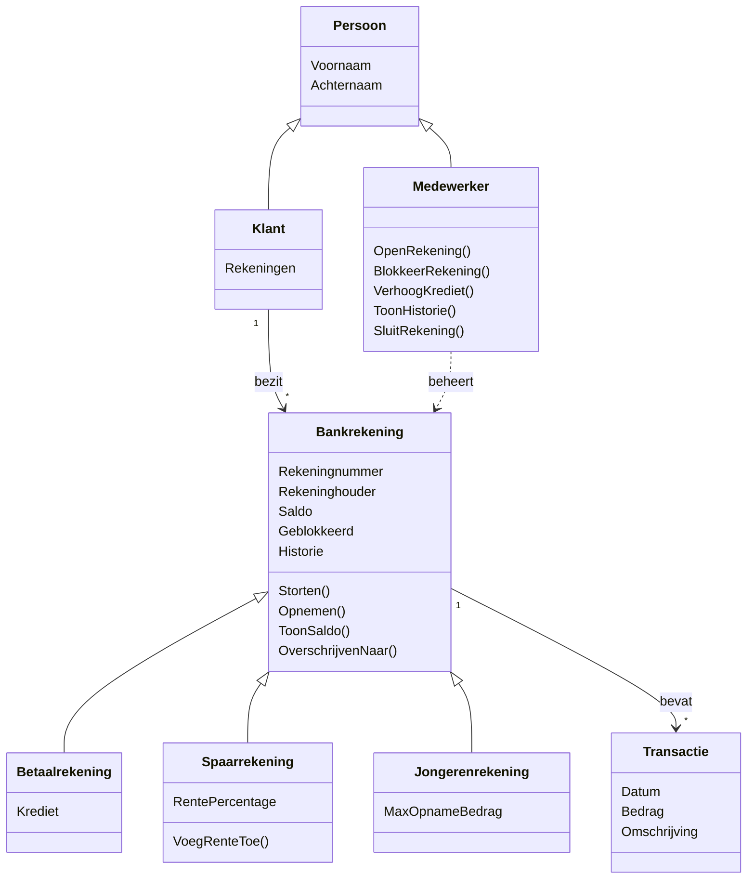

# OOP Stap voor Stap: Van Variabelen naar Encapsulatie en Polymorfisme

## Leerdoel

In deze oefening bouwen we een eenvoudige bankrekening stap voor stap op. We beginnen zonder objectgeoriënteerd programmeren (OOP) en voegen geleidelijk nieuwe concepten toe:

1. Variabelen
2. Klassen en objecten
3. Objecten die andere objecten bevatten
4. Properties (`get` en `set`)
5. Het probleem van onbeveiligde gegevens
6. Encapsulatie (`private`)
7. Constructors

---

## Doel

We bouwen vandaag deze opdracht

## Uitgebreid klassendiagram



## Inhoudsopgave

1. [Stap 1: Variabelen](#stap-1-variabelen)
2. [Stap 2: Eerste klasse](#stap-2-eerste-klasse)
3. [Stap 3: Objecten bevatten andere objecten](#stap-3-objecten-bevatten-andere-objecten)
4. [Stap 4: Publieke velden](#stap-4-publieke-velden)
5. [Stap 5: Het probleem van openbare gegevens](#stap-5-het-probleem-van-openbare-gegevens)
6. [Stap 6: Encapsulatie](#stap-6-encapsulatie)
7. [Stap 7: Constructor](#stap-7-constructor)
8. [Stap 8: Polymorfisme](#stap-8-polymorfisme)
8. [Eindversie](#eindversie)
9. [Samenvatting](#samenvatting)
10. [Verdieping: Properties in MVC en professionele .NET-projecten](#verdieping-properties-in-mvc-en-professionele-net-projecten)
   - [Velden versus Properties](#velden-versus-properties)
   - [Waarom gebruiken we dan properties?](#waarom-gebruiken-we-dan-properties)
   - [Wat betekenen get en set?](#wat-betekenen-get-en-set)
   - [Achter de schermen](#achter-de-schermen)
   - [Alleen lezen toestaan](#alleen-lezen-toestaan)
   - [Alleen de klasse laten schrijven](#alleen-de-klasse-laten-schrijven)
   - [Waarom zie je properties vaak in MVC?](#waarom-zie-je-properties-vaak-in-mvc)

 ---  

# Stap 1: Variabelen

Tot nu toe hebben we gegevens opgeslagen in losse variabelen.

```csharp
string voornaam = "Jan";
string achternaam = "van Kan";

Console.WriteLine($"{voornaam} {achternaam}");

double saldo = 1000;

Console.WriteLine($"Saldo: €{saldo}");

saldo = -5000;

Console.WriteLine($"Nieuw saldo: €{saldo}");
```

## Wat leren we?

- Een variabele slaat één waarde op.
- We kunnen waarden lezen en aanpassen.
- Het programma houdt geen controle op geldige waarden.

### Probleem
Probleem 1:
Als er meerdere personen zijn dan moeten we meerdere variabelen voornaam en achternaam voor elke persoon aanmaken. Dit wordt al snel onoverzichtelijk.
Probleem 2:
Iedereen kan het saldo wijzigen:

```csharp
saldo = -5000;
```

Een foutje is snel gemaakt. Je wilt alleen het saldo wijzigen als je zeker weet dat dit bij de juiste persoon hoort. Technisch gezien is bovenstaande code dus juist maar zakelijk gezien is dit een slecht ontwerp.

---

# Stap 2: Eerste klasse

Gegevens die bij elkaar horen kunnen we groeperen in een klasse.

```csharp
Persoon p1 = new Persoon();

p1.Voornaam = "Jan";
p1.Achternaam = "van Kan";

Console.WriteLine($"{p1.Voornaam} {p1.Achternaam}");

public class Persoon
{
    public string Voornaam;
    public string Achternaam;
}
```

## Wat leren we?

### Klasse

Een klasse is een blauwdruk.

```csharp
public class Persoon
{
}
```

### Object

Een object is een exemplaar van een klasse.

```csharp
Persoon p1 = new Persoon();
```

Je kunt meerdere objecten maken van dezelfde klasse.

```csharp
Persoon p1 = new Persoon();
Persoon p2 = new Persoon();
```

---

# Stap 3: Objecten bevatten andere objecten

Nu maken we een klasse voor een bankrekening.

```csharp
Persoon p1 = new Persoon();

p1.Voornaam = "Jan";
p1.Achternaam = "van Kan";

BankRekening b = new BankRekening();

b.Rekeningnr = "IBAN123";
b.Eigenaar = p1;
b.Saldo = 1000;

Console.WriteLine($"Saldo: €{b.Saldo}");

public class Persoon
{
    public string Voornaam;
    public string Achternaam;
}

public class BankRekening
{
    public string Rekeningnr;
    public Persoon Eigenaar;
    public double Saldo;
}
```

## Wat leren we?

Een object kan verwijzen naar een ander object.

```csharp
public Persoon Eigenaar;
```

Een bankrekening heeft dus een eigenaar.

---

# Stap 4: Publieke velden

Tot nu toe gebruikten we velden:

```csharp
public string Voornaam;
```

In moderne C# gebruiken we meestal properties.

```csharp
public class Persoon
{
    public string Voornaam;
    public string Achternaam;
}
```

## Gebruik
Een veld is een variabele binnen een klasse.
We kunnen deze lezen en schrijven met de puntnotatie.

```csharp
p1.Voornaam = "Jan";
Console.WriteLine(p1.Voornaam);
```
---

# Stap 5: Het probleem van openbare gegevens

Onze bankrekening ziet er momenteel zo uit:

```csharp
public class BankRekening
{
    public string Rekeningnr;
    public Persoon Eigenaar;
    public double Saldo;
}
```

Gebruik:

```csharp
BankRekening b = new BankRekening();

b.Saldo = 1000;

b.Saldo = -5000;
```

Dit compileert zonder fouten.

## Probleem

Iedereen kan het saldo veranderen.

```csharp
b.Saldo = -5000;
```

Misschien willen we dat niet toestaan.

De klasse heeft geen controle meer over haar eigen gegevens.

---

# Stap 6: Encapsulatie

Nu beschermen we het saldo.

```csharp
public class BankRekening
{
    public string Rekeningnr ;
    public Persoon Eigenaar;

    private double _saldo;

    public void Stort(double bedrag)
    {
        if (bedrag > 0)
        {
            _saldo += bedrag;
        }
    }

    public double VraagSaldoOp()
    {
        return _saldo;
    }
}
```

Gebruik:

```csharp
BankRekening b = new BankRekening();

b.Stort(1000);

Console.WriteLine(b.VraagSaldoOp());
```

---

## Wat betekent `private`?

```csharp
private double _saldo;
```

`private` betekent:

> Alleen code binnen dezelfde klasse mag deze variabele gebruiken.

Dus dit werkt niet meer:

```csharp
b._saldo = -5000;
```

De compiler geeft een foutmelding.

---

## Wat is encapsulatie?

Encapsulatie betekent:

> Een object beschermt zijn eigen gegevens en bepaalt zelf hoe deze mogen worden gebruikt.

Het saldo bestaat nog steeds, maar de buitenwereld mag het niet rechtstreeks wijzigen.

Wij moeten gebruikmaken van methodes zoals:

```csharp
b.Stort(1000);
```

of

```csharp
b.VraagSaldoOp();
```

De klasse houdt daardoor controle over haar eigen gegevens.

---

# Stap 7: Constructor

Bij elke nieuwe bankrekening moeten we momenteel alles handmatig invullen.

Dat kan eenvoudiger met een constructor.

```csharp
public class BankRekening
{
    public string Rekeningnr;
    public Persoon Eigenaar;

    private double _saldo;

    public BankRekening(
        string rekeningnr,
        Persoon eigenaar,
        double startSaldo)
    {
        Rekeningnr = rekeningnr;
        Eigenaar = eigenaar;
        _saldo = startSaldo;
    }

    public double VraagSaldoOp()
    {
        return _saldo;
    }
}
```

Gebruik:

```csharp
Persoon p1 = new Persoon
{
    Voornaam = "Jan",
    Achternaam = "van Kan"
};

BankRekening b =
    new BankRekening(
        "IBAN123",
        p1,
        1000);

Console.WriteLine(
    $"Saldo: €{b.VraagSaldoOp()}");
```

---

# Eindversie

```csharp
Persoon p1 = new Persoon
{
    Voornaam = "Jan",
    Achternaam = "van Kan"
};

BankRekening b =
    new BankRekening(
        "IBAN123",
        p1,
        1000);

Console.WriteLine(
    $"Huidig saldo van {b.Eigenaar.Voornaam}: €{b.VraagSaldoOp()}");

public class Persoon
{
    public string Voornaam;
    public string Achternaam;
}

public class BankRekening
{
    public string Rekeningnr;
    public Persoon Eigenaar;

    private double _saldo;

    public BankRekening(
        string rekeningnr,
        Persoon eigenaar,
        double startSaldo)
    {
        Rekeningnr = rekeningnr;
        Eigenaar = eigenaar;
        _saldo = startSaldo;
    }

    public double VraagSaldoOp()
    {
        return _saldo;
    }
}
```

---

# Samenvatting

| Stap | Nieuw concept |
|--------|--------|
| 1 | Variabelen |
| 2 | Klasse |
| 2 | Object |
| 3 | Objecten bevatten andere objecten |
| 4 | Properties |
| 4 | `get` en `set` |
| 5 | Probleem van openbare gegevens |
| 6 | Encapsulatie |
| 6 | `private` |
| 7 | Constructor |

## Belangrijk om te onthouden

- Een **klasse** is een blauwdruk.
- Een **object** is een exemplaar van een klasse.
- **Properties** gebruiken `get` en `set`.
- `get` betekent **lezen**.
- `set` betekent **schrijven**.
- `private` schermt gegevens af.
- **Encapsulatie** betekent dat een object controle houdt over zijn eigen gegevens.
- Een **constructor** zorgt ervoor dat een object direct correct wordt aangemaakt.

---

---

# Stap 8: Polymorfisme

Tot nu toe hebben we geleerd hoe we gegevens kunnen groeperen in klassen, hoe we gegevens kunnen beschermen met encapsulatie en hoe klassen van elkaar kunnen erven.

In deze stap bekijken we **polymorfisme**.

## Wat is polymorfisme?

Polymorfisme betekent:

> Verschillende afgeleide klassen kunnen verschillend reageren op dezelfde methode-aanroep.

We bouwen verder op ons bankrekeningvoorbeeld.

---

## Stap 8.1: Een eerste dochterklasse

We hebben al een algemene bankrekening. Deze breiden we uit met een methode Storten. 

```csharp
public class Bankrekening
{
    public string Rekeningnummer;
    public string Rekeninghouder;

    protected decimal Saldo;

    public void Storten(decimal bedrag)
    {
        if (bedrag > 0)
        {
            Saldo += bedrag;
        }
    }

    public decimal ToonSaldo()
    {
        return Saldo;
    }
}
```

Nu maken we een betaalrekening die overerft van een bankrekening.

```csharp
public class Betaalrekening : Bankrekening
{
}
```

## Wat betekent dit?

```csharp
public class Betaalrekening : Bankrekening
```

betekent:

> Een betaalrekening IS een bankrekening.

De betaalrekening krijgt daardoor automatisch toegang tot alle publieke leden van de ouderklasse.

```csharp
Betaalrekening rekening = new Betaalrekening();

rekening.Storten(100);
Console.WriteLine(rekening.ToonSaldo());
```

Hoewel deze methodes niet in `Betaalrekening` staan, kunnen we ze toch gebruiken.

Dit noemen we **overerving**.

---

## Stap 8.2: Een tweede dochterklasse

Naast een betaalrekening kunnen we ook een spaarrekening maken.

```csharp
public class Spaarrekening : Bankrekening
{
}
```

Nu hebben we drie klassen:

```text
            Bankrekening
                  |
      -----------------------
      |                     |
Betaalrekening      Spaarrekening
```

Beide dochterklassen erven van dezelfde ouderklasse.

---

## Stap 8.3: Verschillend gedrag

Stel dat de standaard bankrekening geld kan opnemen zolang er voldoende saldo aanwezig is.

```csharp
public bool Opnemen(decimal bedrag)
{
    if (bedrag > 0 && Saldo >= bedrag)
    {
        Saldo -= bedrag;
        return true;
    }

    return false;
}
```

Dit betekent:

- Niet rood staan.
- Geen uitzonderingen.
- Gewoon voldoende saldo hebben.

---

## Stap 8.4: Waarom hebben we virtual nodig?

Een betaalrekening mag vaak rood staan.

Een spaarrekening meestal niet.

We willen dus dat verschillende soorten rekeningen verschillend gedrag kunnen hebben.

Daarom maken we de methode `virtual`.

```csharp
public virtual bool Opnemen(decimal bedrag)
{
    if (bedrag > 0 && Saldo >= bedrag)
    {
        Saldo -= bedrag;
        return true;
    }

    return false;
}
```

### Wat betekent virtual?

`virtual` betekent:

> Dochterklassen mogen deze methode vervangen door een eigen versie.

---

## Stap 8.5: Override gebruiken

Nu maken we een speciale versie voor de betaalrekening.

```csharp
public class Betaalrekening : Bankrekening
{
    public decimal krediet = -1000;

    public override bool Opnemen(decimal bedrag)
    {
        if (bedrag > 0 && (Saldo - bedrag) >= krediet)
        {
            Saldo -= bedrag;
            return true;
        }

        return false;
    }
}
```

### Wat betekent override?

`override` betekent:

> Ik vervang de methode uit de ouderklasse door mijn eigen versie.

---

## Waarom kunnen we Saldo gebruiken?

Saldo is gedeclareerd als:

```csharp
protected decimal Saldo;
```

`protected` betekent:

> Alleen de ouderklasse én haar dochterklassen mogen deze variabele gebruiken.

Dit werkt dus:

```csharp
Saldo -= bedrag;
```

Maar dit werkt niet:

```csharp
rekening.Saldo = 1000;
```

Omdat de buitenwereld geen toegang heeft tot een `protected` variabele.

---

## Stap 8.6: Eerste polymorfismevoorbeeld

We maken twee verschillende soorten rekeningen.

```csharp
Betaalrekening betaal = new Betaalrekening();
Spaarrekening spaar = new Spaarrekening();
```

Beide zijn verschillend.

Maar beide zijn ook een:

```csharp
Bankrekening
```

Dat betekent dat we ze samen kunnen opslaan.

```csharp
List<Bankrekening> rekeningen = new List<Bankrekening>();

rekeningen.Add(betaal);
rekeningen.Add(spaar);
```

Dit werkt omdat:

```text
Betaalrekening IS EEN Bankrekening
Spaarrekening IS EEN Bankrekening
```

---

## Stap 8.7: Polymorfisme in actie

Stel dat beide rekeningen €100 bevatten.

```csharp
betaal.Storten(100);
spaar.Storten(100);
```

Vervolgens proberen we €500 op te nemen.

```csharp
foreach (Bankrekening rekening in rekeningen)
{
    bool gelukt = rekening.Opnemen(500);

    Console.WriteLine(gelukt);
}
```

Hoewel we steeds dezelfde methode aanroepen:

```csharp
rekening.Opnemen(500);
```

wordt niet altijd dezelfde code uitgevoerd.

Voor een betaalrekening gebruikt C#:

```csharp
Betaalrekening.Opnemen()
```

Voor een spaarrekening gebruikt C#:

```csharp
Bankrekening.Opnemen()
```

Omdat de spaarrekening geen eigen versie heeft.

Dit noemen we **polymorfisme**.

---

## Complete uitwerking

```csharp
public class Bankrekening
{
    public string Rekeningnummer;
    public string Rekeninghouder;

    protected decimal Saldo;

    public void Storten(decimal bedrag)
    {
        if (bedrag > 0)
        {
            Saldo += bedrag;
        }
    }

    public virtual bool Opnemen(decimal bedrag)
    {
        if (bedrag > 0 && Saldo >= bedrag)
        {
            Saldo -= bedrag;
            return true;
        }

        return false;
    }

    public decimal ToonSaldo()
    {
        return Saldo;
    }
}

public class Betaalrekening : Bankrekening
{
    public decimal krediet = -1000;

    public override bool Opnemen(decimal bedrag)
    {
        if (bedrag > 0 && (Saldo - bedrag) >= krediet)
        {
            Saldo -= bedrag;
            return true;
        }

        return false;
    }
}

public class Spaarrekening : Bankrekening
{
    public decimal RentePercentage = 2.5m;
}
```

Gebruik:

```csharp
Betaalrekening betaal = new Betaalrekening();
betaal.Storten(100);

Spaarrekening spaar = new Spaarrekening();
spaar.Storten(100);

List<Bankrekening> alleRekeningen = new List<Bankrekening>();

alleRekeningen.Add(betaal);
alleRekeningen.Add(spaar);

foreach (Bankrekening rekening in alleRekeningen)
{
    bool gelukt = rekening.Opnemen(500);

    Console.WriteLine(
        $"{rekening.Rekeningnummer}: " +
        $"Opname gelukt? {gelukt} " +
        $"| Nieuw saldo: €{rekening.ToonSaldo()}");
}
```

---

## Samenvatting

### Overerving

```csharp
public class Betaalrekening : Bankrekening
```

betekent:

> Een Betaalrekening IS een Bankrekening.

---

### virtual

```csharp
public virtual bool Opnemen(decimal bedrag)
```

betekent:

> Dochterklassen mogen deze methode vervangen.

---

### override

```csharp
public override bool Opnemen(decimal bedrag)
```

betekent:

> Ik vervang de versie van de ouderklasse.

---

### protected

```csharp
protected decimal Saldo;
```

betekent:

> Alleen de klasse zelf en haar dochterklassen mogen deze variabele gebruiken.

---

### Polymorfisme

```csharp
rekening.Opnemen(500);
```

kan verschillende code uitvoeren afhankelijk van het werkelijke type object.

Een `Betaalrekening` en een `Spaarrekening` reageren dus verschillend op dezelfde methode-aanroep.

Dat noemen we **polymorfisme**.

---

# Verdieping: Properties in MVC en professionele .NET-projecten

> **Voor studenten van de OOP-basisles is dit hoofdstuk optioneel.**
>
> Alle concepten uit dit document kunnen begrepen worden zonder kennis van properties (`get` en `set`).
>
> Werk je later met ASP.NET MVC, Entity Framework of JSON, dan worden properties wel belangrijk.

## Velden versus Properties

Tot nu toe hebben we velden gebruikt:

```csharp
public class Persoon
{
    public string Voornaam;
    public string Achternaam;
}
```

Gebruik:

```csharp
Persoon p1 = new Persoon();

p1.Voornaam = "Jan";
Console.WriteLine(p1.Voornaam);
```

In moderne C#-toepassingen gebruiken we meestal properties:

```csharp
public class Persoon
{
    public string Voornaam { get; set; }
    public string Achternaam { get; set; }
}
```

Gebruik:

```csharp
Persoon p1 = new Persoon();

p1.Voornaam = "Jan";
Console.WriteLine(p1.Voornaam);
```

Voor de gebruiker van de klasse ziet dit er identiek uit.

---

## Waarom gebruiken we dan properties?

Voor eenvoudige console-applicaties zijn publieke velden vaak voldoende.

Properties worden interessant wanneer we meer controle willen toevoegen zonder de code die de klasse gebruikt aan te passen.

Met een veld:

```csharp
public string Voornaam;
```

kan iedereen elke waarde opslaan:

```csharp
p1.Voornaam = "";
```

Met een property kunnen we later regels toevoegen:

```csharp
private string _voornaam;

public string Voornaam
{
    get
    {
        return _voornaam;
    }

    set
    {
        if (!string.IsNullOrWhiteSpace(value))
        {
            _voornaam = value;
        }
    }
}
```

Nu wordt elke wijziging gecontroleerd.

---

## Wat betekenen get en set?

Een property bestaat meestal uit een `get` en een `set`.

```csharp
public string Voornaam { get; set; }
```

### get = lezen

Wanneer je een waarde opvraagt:

```csharp
Console.WriteLine(p1.Voornaam);
```

wordt de `get` uitgevoerd.

### set = schrijven

Wanneer je een waarde toekent:

```csharp
p1.Voornaam = "Jan";
```

wordt de `set` uitgevoerd.

Je kunt onthouden:

| Onderdeel | Betekenis |
|------------|------------|
| get | Waarde lezen |
| set | Waarde wijzigen |

---

## Achter de schermen

Deze korte notatie:

```csharp
public string Voornaam { get; set; }
```

is eigenlijk een verkorte versie van:

```csharp
private string _voornaam;

public string Voornaam
{
    get
    {
        return _voornaam;
    }

    set
    {
        _voornaam = value;
    }
}
```

C# genereert deze code automatisch voor ons.

---

## Alleen lezen toestaan

Soms willen we dat een eigenschap na het aanmaken van een object niet meer gewijzigd kan worden.

```csharp
public string Rekeningnr { get; }
```

Deze waarde kan bijvoorbeeld via de constructor ingesteld worden:

```csharp
public BankRekening(string rekeningnr)
{
    Rekeningnr = rekeningnr;
}
```

Dit werkt:

```csharp
Console.WriteLine(b.Rekeningnr);
```

Dit werkt niet:

```csharp
b.Rekeningnr = "ABC123";
```

De compiler geeft een foutmelding.

---

## Alleen de klasse laten schrijven

Soms mogen andere objecten een waarde lezen, maar mag alleen de klasse zelf deze wijzigen.

```csharp
public double Saldo { get; private set; }
```

Gebruik:

```csharp
Console.WriteLine(b.Saldo);
```

Dit werkt:

```csharp
double huidigSaldo = b.Saldo;
```

Dit werkt niet:

```csharp
b.Saldo = 5000;
```

Alleen code binnen dezelfde klasse mag de waarde aanpassen.

Bijvoorbeeld:

```csharp
public void Stort(double bedrag)
{
    Saldo += bedrag;
}
```

---

## Waarom zie je properties vaak in MVC?

ASP.NET MVC werkt veel met formulieren.

Model:

```csharp
public class Pizza
{
    public string Naam { get; set; }
    public decimal Prijs { get; set; }
}
```

Formulier:

```html
<input asp-for="Naam" />
<input asp-for="Prijs" />
```

Wanneer een gebruiker het formulier verstuurt, vult MVC automatisch de properties van het object in.

Daarom zie je in MVC-projecten bijna altijd properties in plaats van publieke velden.

---

## Samenvatting

Voor een console-app zijn velden vaak voldoende:

```csharp
public string Voornaam;
```

Voor professionele .NET-projecten worden meestal properties gebruikt:

```csharp
public string Voornaam { get; set; }
```

Belangrijk:

- Een veld slaat gegevens op.
- Een property lijkt op een veld, maar biedt extra controle.
- `get` betekent lezen.
- `set` betekent schrijven.
- `get;` betekent alleen lezen.
- `get; private set;` betekent dat iedereen mag lezen, maar alleen de klasse zelf mag schrijven.
- ASP.NET MVC en veel andere .NET-frameworks werken standaard met properties.


